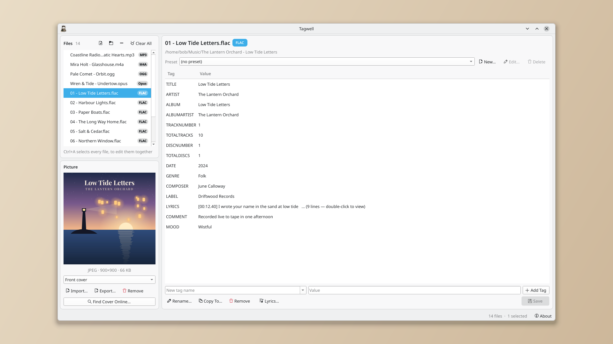
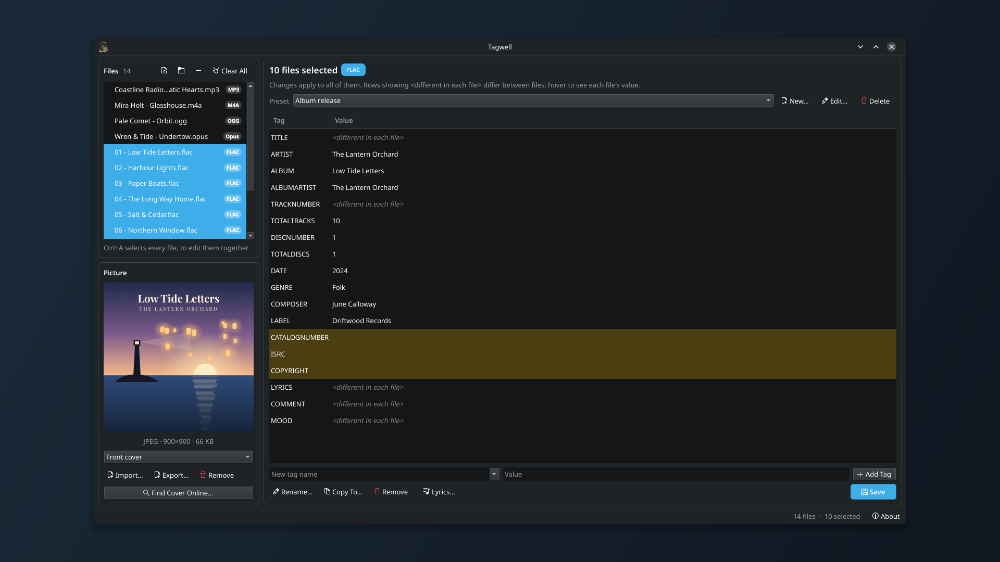
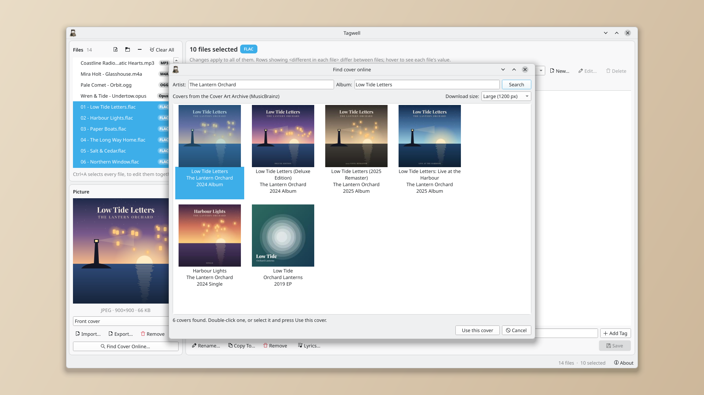
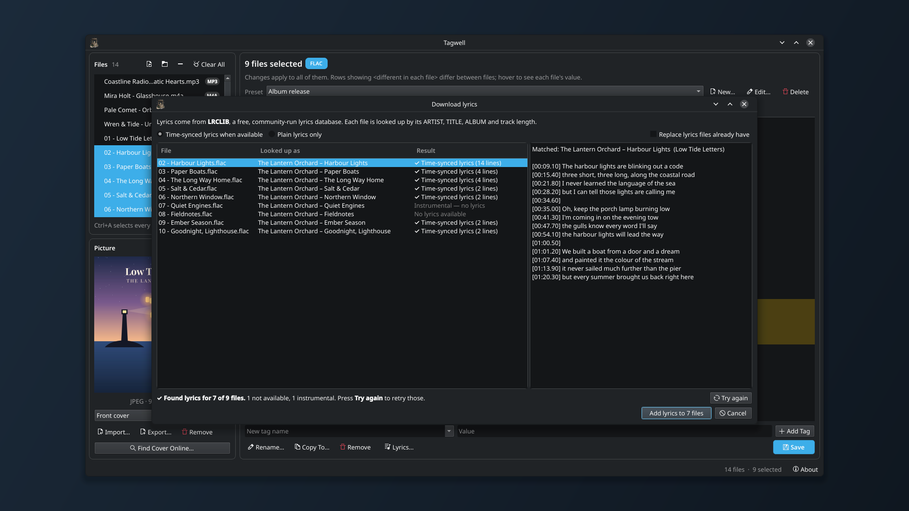

# Tagwell

A simple tag editor for your music on Linux. Edit the tags, cover art and lyrics of
FLAC, MP3, M4A (AAC/ALAC), OGG Vorbis and Opus files, one song or a whole album at a time.

[](https://snapcraft.io/tagwell)
<p align="center">



</p>


## Features

- See and edit every tag, and add your own custom tags
- Edit many files at once, even of different formats: rows that differ between files
  show as *&lt;different in each file&gt;*
- Rename a tag, or copy it into another tag, keeping each file's own value
- Presets: save the tags you always use, and missing ones show up as highlighted blank rows
- Choose whether blank tags are saved or left out
- Cover art: view, import, export, remove and set the picture type, or find covers online
  from the [Cover Art Archive](https://coverartarchive.org) (MusicBrainz)
- Lyrics: download plain or time-synced lyrics from [LRCLIB](https://lrclib.net)
- Drag files or folders onto the window, or open several files from your file manager into
  the same window
- Follows your desktop's colours, font and icons on KDE Plasma, and light or dark mode elsewhere

## Install

**Snap Store**

```
sudo snap install tagwell
```

To edit music on USB drives or other disks, let the snap see them once:

```
sudo snap connect tagwell:removable-media
```

**AppImage**

Download `Tagwell-x.y-x86_64.AppImage` from the
[latest release](https://github.com/bobwellapps/tagwell/releases/latest), make it
executable and run it. Nothing else needs installing.

```
chmod +x Tagwell-*-x86_64.AppImage
./Tagwell-*-x86_64.AppImage
```

You can also right-click the file, open Properties and tick "Allow executing file as
program", then double-click it.

**From source**

Tagwell is a single Python file and needs PySide6 and mutagen.

```
python3 -m venv ~/.venvs/tagwell
~/.venvs/tagwell/bin/pip install -r requirements.txt
~/.venvs/tagwell/bin/python tagwell.py [files or folders]
```

Keep `tagwell.png` next to `tagwell.py` so the app picks up its icon. A sample menu
entry is in `packaging/tagwell.desktop`.

## Using it

| To do this | Do this |
| --- | --- |
| Add files or a folder | The buttons above the file list, Ctrl+O / Ctrl+Shift+O, or drag them in |
| Edit several files together | Select them in the file list (Ctrl+A selects every file) |
| Add a tag | Type a name and value under the tag list and press Add Tag, or Ctrl+T |
| Rename a tag | Select it and press Rename… or F2 |
| Select several tags | Ctrl-click, Shift-click, or drag across them |
| Use a preset | Pick it from the Preset list; New… makes one from scratch |
| Change the cover | Import…, Export…, Remove or Find Cover Online… under the picture |
| Get lyrics | Lyrics… under the tag list |
| Save | Save, or Ctrl+S (saves every changed file) |

Presets are kept in `~/.config/tagwell/presets.json` (for the snap,
`~/snap/tagwell/current/.config/tagwell/presets.json`).

## Licence

Tagwell is free software under the
[GNU General Public License, version 3 or later](LICENSE).

The Tagwell name and icon are not covered by that licence and may not be used for
other projects or forks. See [TRADEMARKS.md](TRADEMARKS.md).
